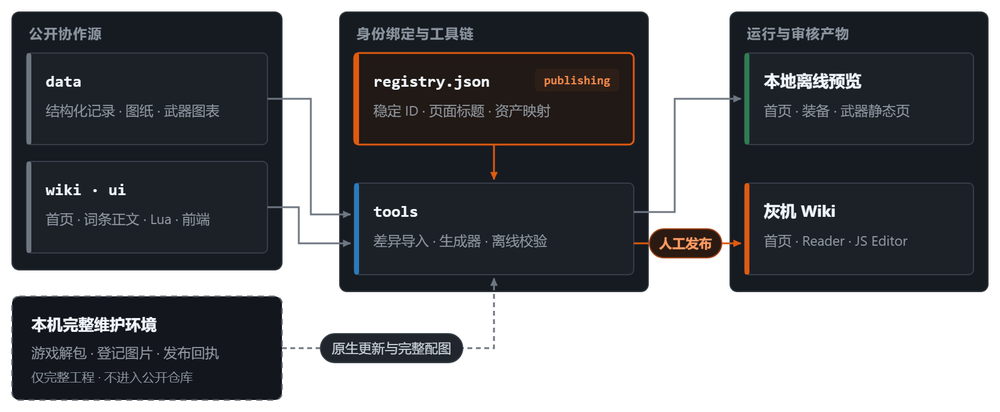

本仓库维护《全境封锁2》中文灰机 Wiki 的开源站点内容、结构化资料、Lua Reader、浏览器端表单编辑器，以及离线预览与发布工具链。

<p>
  <a href="https://td2.huijiwiki.com/"></a>
  <br>
  <a href="RIGHTS.md"></a>
  <a href="#-从源码运行"></a>
  <br>
  <a href="AGENTS.md"></a>
  <a href="docs/github-sync.md"></a>
</p>

##  目录

- [核心构成](#-核心构成)
- [系统架构](#-系统架构)
- [工程地图](#-工程地图)
- [从源码运行](#-从源码运行)
- [公开仓库与完整维护环境](#-公开仓库与完整维护环境)
- [协作与双仓同步](#-协作与双仓同步)
- [权利与署名](#-权利与署名)

##  核心构成

- **站点首页与动态日程**：维护首页栏目导航框架、赛季进度环与倒计时、当日活动轮播，以及站点统计组件。
- **结构化资料与词条内容**：维护装备、武器（含基础数值、精准度散布、后坐力轨迹与射程衰减模型）、材料、制作与战利品指南，以及机制与规则词条。
- **Lua Reader 与 HUD 样式**：独立运行于灰机 Wiki 的展示层，沿用游戏深色 HUD 视觉基线，提供统一品质资料卡、PvE / PvP 模式切换、分类导航箱与公共页面操作。
- **浏览器端 JS Editor**：面向管理员的站内表单编辑器，按稳定身份加载资料，编辑天赋脚注、其他资料、补充正文与编辑摘要；局部写回时保留未改动原文，并在保存前校验最新修订冲突。
- **离线预览与发布工具链**：发布工具采用 MANUAL 模式。`build` 生成本地审核包，`prepare` 复核包内容。Wiki 写入经授权后由维护者在浏览器中完成。配合原生差异导入、本地 Lua 预览、依赖校验和双仓同步，可在离线环境核对修改。

##  系统架构

<picture>
  <source media="(prefers-color-scheme: dark)" srcset="docs/readme-assets/architecture-dark.png">
  <source media="(prefers-color-scheme: light)" srcset="docs/readme-assets/architecture-light.png">
  
</picture>

##  工程地图

| 目录 | 维护内容 | 维护入口 |
| --- | --- | --- |
| `data/` | 装备与武器记录、制作关系、原生基准与武器图表 | [装备维护](docs/equipment-maintenance.md) |
| `wiki/` | 首页、各类词条、重定向、模板、Lua 与站点样式 | [首页维护](docs/homepage.md)<br>[组件关系](docs/td2-reader-component-architecture.md) |
| `ui/` | Reader 样式脚本，JS Editor 源码与构建锁文件 | [组件关系](docs/td2-reader-component-architecture.md)<br>[Editor 构建](ui/editor/production/README.md) |
| `publishing/` | 稳定 ID、Wiki 标题、本地路径与发布基准 | [发布契约](docs/publishing-contract.md)<br>[图片命名](docs/IMAGE-NAMING-STANDARD.md) |
| `tools/` | 原生导入、生成器、本地预览、发布准备与同步 | [资源查询](tools/asset_import/README.md)<br>[部署流程](docs/deployment.md) |
| `tests/`、`evidence/` | 自动化测试、共享夹具、核验依据与图表输入 | [测试夹具](tests/fixtures/README.md) |
| `docs/`、`.agents/` | 维护规范、架构说明与项目操作导航 | [工程约定](AGENTS.md)<br>[项目 Skill](.agents/skills/td2-wiki/SKILL.md) |

##  从源码运行

在仓库根目录准备 Python 3.12+ 独立环境与 Node 依赖（PowerShell 示例）：

```powershell
py -3.12 -m venv .venv
$py = '.\.venv\Scripts\python.exe'
& $py -m pip install -r tests/requirements.txt
npm ci --prefix ui/editor/tooling --ignore-scripts
```

### 1. 数据与生成一致性检查

```powershell
node tools/equipment/catalog.cjs check
& $py -B -m tools.equipment.weapons check
node --test tests/test_acquisition_mechanisms.cjs
```

### 2. 本地离线预览（无需游戏解包）

本地预览使用仓库的模板和 Lua。`--without-assets` 使用缺图占位，可查看首页、装备样本和代表性武器页面及其图表。

```powershell
# 首页栏目、赛季进度与活动日程
& $py -B -m tools.homepage_preview dist/home-review --without-assets

# 武器资料与控制力/射程图表
& $py -B -m tools.equipment.weapons_preview dist/weapon-review --without-assets

# 装备资料卡与 JS Editor 编辑往返
node ui/editor/production/build.cjs dist/editor-review --local-preview
& $py -B -m tools.equipment.preview build dist/equipment-review --editor-export dist/editor-review/local-preview --without-assets
& $py -B -m tools.equipment.preview serve dist/equipment-review --port 8767
```

首页与武器预览直接打开各自目录下的 `index.html`（无图首页的站点统计显示破折号，站点动态快照留空）；装备编辑往返在启动 `serve` 后访问 `http://127.0.0.1:8767/index.html`。编辑和保存都使用内存中的样本，刷新浏览器会恢复原始样本。结束后按 `Ctrl+C`。每次预览请使用新的输出目录。

##  公开仓库与完整维护环境

Wiki 业务图片由灰机文件系统及维护者本地资源库管理，本仓库通过 `publishing/registry.json` 跟踪稳定 ID、Wiki 标题、本地路径与登记图片的内容 SHA-256（例如 `File:TD2-UI-Loadout11-Icon.png` 对应站内文件页）；最后确认的线上修订、文件版本和摘要另记于 `publishing/baseline.json`。

| 任务类型 | 公开仓库即可完成 | 额外需要完整维护环境 |
| --- | --- | --- |
| 首页、词条、Catalog、武器图表与前端开发 | 是（`tools.equipment.weapon_chart_study` 默认重算并核对控制力图表数据，`--output` 可导出候选） | — |
| 无图静态预览与源码级单元测试 | 是 | — |
| 完整配图预览、登记图片校验 | — | 按 `registry.json` 的 `source` 放置登记图片，首页预览另需本地活动快照和头像 |
| 游戏版本解包更新与含私有夹具的全量回归 | — | `resources/game/current/`、Hunter 与本地来源索引（[资源更新](docs/game-resources.md)） |
| 线上发布包准备与回退 | — | 登记图片、发布回执与远端修订核对（[部署流程](docs/deployment.md)） |

##  协作与双仓同步

- **提交 Pull Request**：从最新 `main` 切出分支，修改归属源并运行受影响的生成器与测试，将对应的生成模块或模板随输入一并提交。
- **与完整维护工程同步**：本仓库通过 `tools.github_sync` 与完整维护工程交换共享源。按本机实际布局配置 `td2sync.full`，相对路径以协作仓库根目录为准。以下示例适用于 `GitHub/TD2-Wiki` 与 `Workspace/WEB-TD2-Wiki` 共用同一基目录的布局。两边共享文件一致且协作仓干净时执行 `checkpoint` 建立共同检查点。新增共享文件需显式指定相对路径。

```powershell
git config --local td2sync.full ../../Workspace/WEB-TD2-Wiki
& $py -B -m tools.github_sync status
& $py -B -m tools.github_sync export   # 带入完整工程改动（可附加精确相对路径仅同步指定文件）
& $py -B -m tools.github_sync import   # 回收协作仓库改动（可附加精确相对路径仅同步指定文件）
```

`td2-manual` 标记的文件在两个环境中按职责分别维护，详见[同步说明](docs/github-sync.md)。本地同步、分支提交、Git 推送 / PR 与灰机 Wiki 线上发布均需各自独立授权；Git 合并与推送不会自动触发灰机 Wiki 发布。

##  权利与署名

| 范围 | 许可 | 说明 |
| --- | --- | --- |
| 原创软件、测试与配套软件说明（`tools/`、`ui/`） | **MIT** | 全文见 [LICENSES/MIT.txt](LICENSES/MIT.txt)，分项索引见 [LICENSE](LICENSE) |
| Wiki 贡献者原创的页面、模板内容与站内创作 | **CC BY-SA 3.0 Unported** | 已在灰机发表且项目拥有完整权利的原创程序逻辑可在 MIT 与 CC BY-SA 3.0 间选择 |
| 项目有权授权的数据选取、编排与原创图表数据（`data/`） | **CC BY 4.0** | 署名与外部依据见 [RIGHTS.md](RIGHTS.md) · [THIRD_PARTY.md](THIRD_PARTY.md) |
| 引用的游戏名称、文本、图标、美术与商标 | 原权利人保留 | 归 Ubisoft 及相应权利人所有，不随上述开源许可再授权 |

README 的 14 张配图使用《全境封锁2》加载界面的凤凰图标和游戏 UI 图标，配合项目自行排版的标题和 HUD 按钮，用于非商业社区展示。游戏素材权利归 Ubisoft 及相应权利人所有。详见[第三方署名](THIRD_PARTY.md)。
